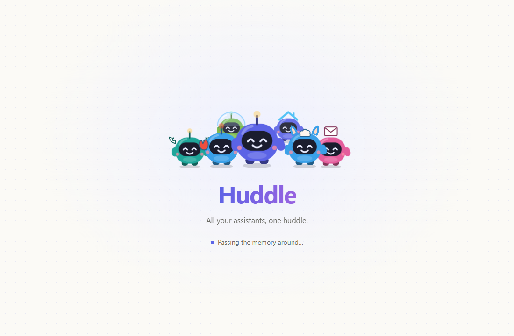
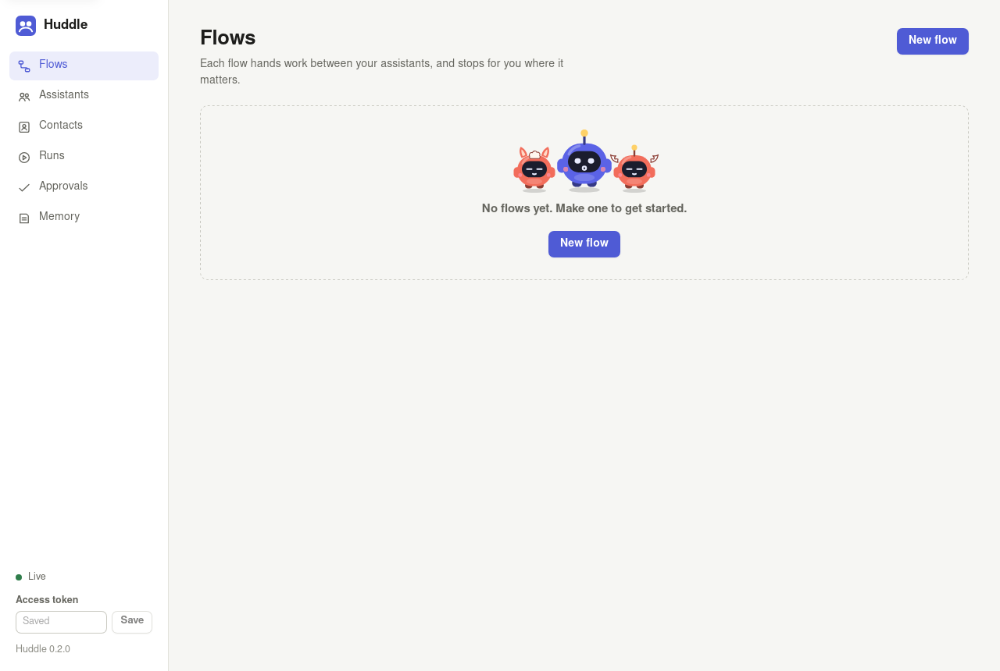

# Huddle

**n8n for personal assistants.** Connect the AI assistants you already use, give them one shared
memory, and draw how they hand work to each other, with you approving anything that matters.



> Status: early, and self-hosted. The canvas, the flow engine, shared memory, approvals, schedules,
> webhooks, email in and out, "describe it", [Just ask](#just-ask), the [Huddle button](#the-huddle-button),
> and connectors for OpenClaw, Hermes Agent, any A2A agent,
> OpenAI-style APIs, Ollama, vLLM, the agent CLIs on your computer (Claude Code, Codex, OpenCode), agents
> in NVIDIA OpenShell sandboxes, Home Assistant, Agent Zero and Sochen all work today, from one command,
> one container, or the [Linux app](#the-linux-app). Approvals
> on your phone and the hosted version are next. See [Roadmap](#roadmap).

---

## Why

You probably have more than one assistant already: one in your chat app, one that reads your email,
an open-source one running at home, a few that came with the tools you pay for. Each is good at
something. None of them talk to each other, and each one knows a different slice of your life.

Workflow tools like n8n can glue APIs together, but an assistant isn't an API call. It has its own
skills, its own memory and its own judgement, and it can be wrong. Huddle treats each assistant as a
teammate: you put them on a canvas, say who does what, and decide where you want a say.

## What it does

- **Assistants are the building blocks.** Each block on the canvas is a whole assistant, reached
  through a connector, rather than forty hand-wired API nodes.
- **One shared memory, with permissions.** Your assistants read from the same notes about you, and you
  choose which slice each one sees: your work bot gets your calendar, not your health notes. What an
  assistant learns goes in as a suggestion; only you make it part of the memory.
- **Approvals are a step, not a promise in a prompt.** Put an approval anywhere in a flow and the run
  stops there until you tap yes or no. Nothing that spends, sends or books gets past one without you.
- **Runs survive waiting.** A run that's waiting for your approval is saved, so it carries on later,
  after a restart, from exactly where it stopped.
- **Runs start how you like.** Press Run, put it on a schedule ("every 2h", or "Fridays at 18:00" by
  your time zone's clock: `{ "type": "schedule", "at": "18:00", "on": ["fri"], "timezone": "Asia/Kolkata" }`),
  give it a webhook address that anything can post to, or an email address: mail to it starts the flow.
- **A receipt for every run.** Each run's page says where your data went: which service each request
  reached (or that it stayed on this machine), how much was sent, which of your notes went with it, and
  what a fact check searched the web for. It's worked out from the run's own log, so it's the record of
  what happened, not a setting's promise.
- **Facts checked before you say yes.** An approval with `"check": true` looks its facts up on the web
  first and shows what the sources say ([below](#check-the-facts-before-you-say-yes)).
- **Your assistants can call it too.** Huddle is an A2A agent itself, so OpenClaw, Hermes or any other
  A2A assistant can hand a job to one of your flows. And it's an MCP server, so Claude Code, Claude
  Desktop, Cursor or any MCP client gets your flows as tools.
- **One API to every assistant you run.** Huddle's router is OpenAI-compatible: point any app or SDK
  at it and the model name is your assistant (`"hermes"`, `"claw"`, or `"auto"` to let Huddle pick).
  Every call still gets only that assistant's memory, and shows in Runs.
- **Sandboxed assistants, with you holding the keys.** Run an agent inside an
  [NVIDIA OpenShell](https://github.com/NVIDIA/OpenShell) sandbox and use it in a flow. When OpenShell
  blocks something the agent reaches for, the request lands in your Huddle approvals with OpenShell's
  own risk check, and the agent carries on once you allow it.
- **Describe it.** Write the flow in a sentence; Huddle drafts it on the canvas for you to check.
- **Just ask.** Say or type what you need in one sentence. Huddle works out who should do it (one of your
  saved flows, the one assistant who can, or a team of them in order), says the plan, runs it, and ends a
  team's run with Hud saying what each came back with ([below](#just-ask)).
- **A button on your desk.** Hold it and talk, tap to pick a flow, hold to say yes. Its screen shows which
  of your assistants has the work, and its camera can show Huddle what you mean
  ([below](#the-huddle-button)).
- **Yours to host.** One command runs it on your own machine or server, with your data in one SQLite
  file. A hosted version is coming for people who'd rather not run anything.

## An example

> When an invoice email arrives, the finance assistant reads it and logs it. If it's over $200, ask me
> before paying. Then the calendar assistant adds a reminder for the due date.

```jsonc
{
  "name": "Invoices",
  "assistants": [
    { "id": "finance",  "connector": "sochen", "memory": ["money"] },
    { "id": "calendar", "connector": "http", "url": "http://localhost:8787/ask", "memory": ["calendar"] }
  ],
  "steps": [
    { "id": "read",   "type": "agent", "agent": "finance", "ask": "Read this invoice and give me the vendor, amount and due date as JSON: {{input}}" },
    { "id": "big",    "type": "condition", "if": "{{read.data.amount}} > 200", "then": "ask-me", "else": "remind" },
    { "id": "ask-me", "type": "approval", "message": "Pay {{read.data.vendor}} ${{read.data.amount}}?", "next": "remind" },
    { "id": "remind", "type": "agent", "agent": "calendar", "ask": "Add a reminder on {{read.data.due}} to pay {{read.data.vendor}}." },
    { "id": "learn",  "type": "memory", "slice": "money", "note": "{{read.data.vendor}} sends invoices." }
  ]
}
```

## Just ask

One sentence in, and your assistants work on it as a team. You don't pick a flow or an assistant first: you
say what you need, and Huddle works out who does it.

> Plan my work for next week, and find me a relaxed weekend trip near Bengaluru.

One quick call to a model (NVIDIA Nemotron 3 Super on Token Factory, with thinking off) reads that beside your
saved flows and assistants, by their descriptions, and picks one of three:

- **A saved flow** that already does it, run with your words as its input.
- **The one assistant who can do it alone**, through the [router](#the-router-one-api-to-every-assistant-you-run).
  Most questions are this.
- **A team:** each assistant's part, with an approval before anything that sends, spends or books. The model
  says, for each part, which other parts' answers it uses; parts that don't use each other's work **at the
  same time** (a [together step](#several-at-once-a-together-step)), and a part that uses another's answer
  waits for it and sees it. Each keeps to its own part. One that can't be reached is skipped rather than
  stopping the rest, and Hud (Huddle's own quick model, Nemotron Lightning) ends the run by saying what each
  came back with.

Huddle says the plan before the work starts, built from the plan as it will run, so "while" means at the same
time and "then" means it waits ("OpenClaw pulls your work for next week while Hermes finds something fun near
Bengaluru"). The run's page shows the plan, with a row for each assistant as it works. A team that worked
out is one click from being yours: **Keep this team** on its run page saves it as a flow on your button.
Flows and assistants that look at photos aren't offered, since Just ask takes none.

On the sentence above, with OpenClaw and Hermes running in Docker on Nemotron 3 Super, the plan was ready
about 2 seconds after the words were heard; OpenClaw and Hermes worked on their parts at the same time, and
Hud's answer was spoken 6 to 10 seconds after that. Asked one after the other, the same team took 35 seconds.

### Several at once: a together step

A flow can ask several assistants at the same time, each on its own part, and go on once all of them have
answered. None sees another's answer; the steps after see each one's by its id, and all of them, by name, as
the together step's own text:

```jsonc
{ "id": "both", "type": "together", "steps": [
    { "id": "work", "agent": "claw",   "ask": "List what's due at work next week: {{input}}" },
    { "id": "home", "agent": "hermes", "ask": "Find something fun to do on Saturday: {{input}}", "optional": true }
  ], "next": "wrap" },
{ "id": "wrap", "type": "agent", "agent": "hud", "ask": "Say what came back:\n{{both.text}}" }
```

A member marked `optional` can fail without stopping the others. On the canvas it's one block (**Together**
in the palette), and the run page and the button show everyone in it working at once.

It's the first choice on the [button](#the-huddle-button) and in the canvas's quick bar, and it's in the API
and on the MCP server:

```bash
curl -X POST http://localhost:7700/api/ask -H "Authorization: Bearer $HUDDLE_TOKEN" \
  -H "content-type: application/json" -d '{"text": "Plan my week, then find a quiet weekend trip"}'
```

From Claude Code, Cursor or any MCP client, the `just_ask` tool takes the same sentence and waits for the
answer (see [Use Huddle from Claude, Cursor or any MCP client](#use-huddle-from-claude-cursor-or-any-mcp-client)).
Just ask needs a model to plan with: `NEBIUS_API_KEY`, or `HUDDLE_LLM_URL` and `HUDDLE_LLM_MODEL`.

## The Huddle button

A button on your desk for your assistants, built on an ESP32-S3 camera board with a 1.8" screen, a mic and a
speaker ([the firmware, the parts and how to set it up](firmware/huddle-button/README.md)):

- **Hold and talk.** It starts the flow you picked, or [Just ask](#just-ask), with what you said. Your voice is
  heard and answers are spoken on your own machine, by NVIDIA Nemotron 3.5 ASR and Magpie TTS through
  NeMo-Speech; only the words go on to your assistants, and the run's receipt says so.
- **Hold to say yes.** An approval shows as one line and is said aloud. A deliberate one-second hold is yes, a
  tap is no, so a knock never approves anything.
- **See who has the work.** Hud and your assistants appear as Huddlers; OpenClaw and Hermes appear as their own
  logos, ringed by dots that spin in the logo's colour while they work. Two working at the same time stand
  side by side, each in its own ring, until one finishes. A team's line ("OpenClaw > Hermes") picks out
  whoever has it now, and the answer comes up in a bubble as it's said.
- **Show it something.** On a flow whose assistant sees photos, the button takes one as you start to talk:
  "What is this?" pointed at a parcel or a bill goes to Nemotron 3.5 Super VL with the photo. In testing, the
  photo, the question and the spoken answer took about 9 seconds.
- **No Wi-Fi or administrator needed.** It reaches Huddle over its USB cable, through the canvas's **Devices**
  page in Chrome or Edge. Wi-Fi works too. The Devices page also has a virtual button, to try it all without
  the hardware.

## Shared memory

Notes live in slices (`money`, `home`, `health`), and an assistant reads only the slices its `memory`
lists. What a flow or an assistant learns waits as a suggestion until you keep it. Passwords, card
numbers, one-time codes and keys stay out: they're masked in suggestions, and a note you write with
one is refused.

Each request carries the kept notes from the assistant's slices, up to 4,000 characters
(`HUDDLE_MEMORY_BUDGET`), with any note over 1,200 characters clipped. When the slices hold more than
that, the notes that match the request go first, then the newest. The matching is
[Sochen](https://sochen.dev)'s memory engine, ported to SQLite: a note scores by the request's words it
holds, each weighted by how rare it is among your notes (BM25's idf, without length scaling), so
"passport" outweighs a name that's in half of them. That works with nothing to set up. Two extras are
optional, from any provider:

- **Embeddings** (`HUDDLE_EMBED_URL`, `HUDDLE_EMBED_MODEL`, `HUDDLE_EMBED_KEY`, any OpenAI-compatible
  API): notes are found by meaning too, so "kitten" finds "Miso is a cat". Vectors stay in the same
  SQLite file.
- **A reranker** (`HUDDLE_RERANK_URL`, `HUDDLE_RERANK_MODEL`, `HUDDLE_RERANK_KEY`: Voyage, Cohere or
  Jina): reads the matches against the request and puts the best first.

If either is down, memory carries on without it, and a run never fails over memory. **Memory** on the
canvas has a search box that ranks notes the same way.

A note a slice already holds isn't added again, whatever its case, spacing or full stop. **Tidy up** on the
Memory page finds the rest. Exact copies are found on your machine. With a model set up (`NEBIUS_API_KEY`
puts this on Nemotron 3 Super), it also reads each slice's kept notes, one slice at a time and only when
you click, for:
- notes that say the same thing in other words;
- notes that can't both be true, like an old and a new city.

Each is a proposal you apply or leave: forget the copies, merge them into one note you can edit, or keep
just one of two notes that disagree.

A model's one note is checked before you see it. It must name no person, place or number its notes don't,
and keep most of what they say. In testing, Nemotron offered "Moved to Pune in September 2026" as the one
note for a Bengaluru/Pune conflict, dropping "prefers trains to flights, budget-minded" from the older
note. That note now fails the check, so the conflict shows with "Keep only this" on each note and no
one-note offer.

**Learn from what you say** (a switch on the Memory page, off until you turn it on) lets memory grow on
its own:
- **When:** after a flow you run in the canvas, or a chat through the router.
- **What it reads:** Nemotron 3 Super reads what you wrote, and only that: not the answers, not your notes.
  It suggests up to three lasting things about you, like "Mother lives in Kochi" or "Does not drink
  alcohol". They wait in Memory like any other suggestion.
- **What it never reads:** mail, webhooks, and messages from contacts or AI clients. A flow whose input
  isn't your own words, like a pasted email in *Who's this?*, says `"learn": false`.
- **What gets dropped:** a suggestion naming a person, place or number you didn't say, and one that
  memory already holds in other words.
- **Receipt:** the run's receipt shows your words going to the model, and the run log lists what it
  suggested. About $0.00015 a message.

It runs on Super because Lightning, tried first, kept the request itself ("Weekend trip with a companion
from Bengaluru to Mysuru") and filed "Hates early flights" under money.

In Sochen, on Postgres with Voyage embeddings and reranking and a reader model for counting
questions, this engine scored 89.2% on LongMemEval. That number is Sochen's: Huddle has the ranking
but not the reader, stems words with SQLite's Porter stemmer rather than Postgres', and hasn't been
benchmarked yet.

## NVIDIA Nemotron on Nebius Token Factory

With `NEBIUS_API_KEY` set, everything Huddle thinks for itself runs on NVIDIA Nemotron through
[Nebius Token Factory](https://tokenfactory.nebius.com), each job on the size it needs:

| Model | What it does in Huddle |
|---|---|
| Nemotron 3.5 Lightning (`nvidia/Nemotron-3_5-Lightning`) | routes each ask to the assistant that fits (`"auto"`), lists the facts an approval should check, picks how an answer is shown, and, as Hud, sums up a Just ask team |
| Nemotron 3 Super (`nvidia/nemotron-3-super-120b-a12b`) | plans Just ask, weighs the sources in a fact check, fills in tables and charts, tidies memory and learns from what you say |
| Nemotron 3 Ultra (`nvidia/Nemotron-3-Ultra-550b-a55b`), thinking on | drafts whole flows from a sentence ("describe it") |
| Nemotron 3.5 Super VL (`nvidia/Nemotron-3.5-Super-VL`) | reads photos, like a bill from the button's camera |

Token Factory is what makes several model calls per request practical:

- **One key, every size.** The API is OpenAI-compatible, so a job moves to another size by changing one
  model name, with no GPU to run. Hermes can run on Nemotron through it too
  ([`hermes-config.yaml`](examples/openshell-hermes/hermes-config.yaml)).
- **Live prices.** Huddle reads Token Factory's public catalog (`/api/public/models_info`) when it starts,
  so the router knows what each size costs. On 24 everyday asks it sent every one to the right size, and
  quick asks and messages cost 89% less than sending everything to Ultra
  ([the benchmark](docs/benchmarks/routing.md)).
- **Thinking only where it pays.** Nemotron thinks first unless told not to. Huddle sets
  `chat_template_kwargs.enable_thinking`, so a routing call takes 0.4 s and 16 tokens instead of 5.8 s
  and 1,344.
- **A cap on its own calls.** Every call Huddle makes for itself goes through one meter, held to
  `HUDDLE_BUDGET` and `HUDDLE_OWN_CALLS_PER_MINUTE`.

Huddle uses Token Factory only. None of its Nemotron calls needs a GPU of your own, so there's nothing to
run on Nebius AI Cloud. Two other NVIDIA open-source tools are part of it:

- [OpenShell](#sandboxed-assistants-with-nvidia-openshell) sandboxes agents, with a provider profile that
  binds `NEBIUS_API_KEY` to Token Factory alone;
- on [the Huddle button](#the-huddle-button), Nemotron 3.5 ASR and Magpie TTS hear and speak on your own
  machine, through NVIDIA NeMo-Speech.cpp.

## Connectors

| Connector | Reaches | Status |
|---|---|---|
| **`openclaw`** | [OpenClaw](https://github.com/openclaw/openclaw), through its A2A channel | ready |
| **`hermes`** | [Hermes Agent](https://github.com/NousResearch/hermes-agent), through its A2A gateway | ready |
| **`a2a`** | any agent that speaks [A2A](https://a2a-protocol.org) 1.0 (Agent2Agent) | ready |
| **`openai`** | anything with an OpenAI-style chat API: Open WebUI, AnythingLLM, LibreChat's Agents API, Letta, and the API servers of OpenClaw and Hermes | ready |
| **`ollama`** | a model in [Ollama](https://ollama.com), on your machine or on ollama.com | ready |
| **`vllm`** | your own model served by [vLLM](https://github.com/vllm-project/vllm), on your machine or a GPU server | ready |
| **`cli`** | the agent CLIs on the computer Huddle runs on, signed in as you use them: Claude Code, Codex, OpenCode | ready |
| **`openshell`** | any agent with a one-shot command (Hermes, OpenCode, Claude Code, Codex…) inside an [NVIDIA OpenShell](https://github.com/NVIDIA/OpenShell) sandbox | ready |
| **`pact`** | a business's support agent over [PACT](https://github.com/openpactprotocol/openpactprotocol), with Huddle as your personal agent: its identity, and signing in to act for you | ready |
| **`sochen`** | [Sochen](https://sochen.dev)'s agent and its pets, through the Agent API | ready |
| **`monid`** | one paid data tool from [Monid](https://monid.ai)'s catalog (job listings, reviews, prices, search results), within a spend cap per run | ready |
| **`homeassistant`** | [Home Assistant](https://github.com/home-assistant/core)'s Assist, through its conversation API | ready |
| **`agentzero`** | [Agent Zero](https://github.com/agent0ai/agent-zero), through its external API | ready |
| **`instinct`** | [Open Instinct](https://github.com/mariagorskikh/open-instinct), the personal agent you text, through its owner chat | ready |
| **`email`** | people, by email through [Resend](https://resend.com), always to the addresses you set (see [Email](#email)) | ready |
| **`http`** | anything with a simple `{ ask } → { text }` API | ready |
| **`mock`** | a stand-in assistant for building and testing flows | ready |
| `mcp` | assistants and tools exposed as Model Context Protocol servers | next |

"Ready" means built and tested against each project's documented API. OpenClaw (2026.9.9), Hermes
Agent (0.21.6) and Ollama (0.40) are also tested against real installs: a flow where OpenClaw plans, you
approve, and Hermes follows up, each reading only its own slice of memory, and a local model answering
from the slice it was given. PACT is tested against its reference Provider: Skyline Airways checked a flight,
asked for more permission to rebook it, and Huddle checked the signed receipt of each. Monid is tested against its live API: a
Google Jobs search came back with ten postings in 26 seconds, for $0.0024. The others haven't been run against a
live install yet, so reports of what breaks are very welcome. Assistants with no way in from outside
(some consumer apps have none) can't be connected yet, unless they read email (see [Email](#email));
reaching them by a messaging channel is on the roadmap.

**Open Instinct acts as its owner.** Everything Huddle sends it runs with its owner's full powers, whoever
started the flow. If contacts or strangers can start a flow that asks it (see [who can start a flow](#who-can-start-a-flow)),
put an approval step in front of that step.

### Bring your assistant

**OpenClaw.** Turn on its A2A channel and give Huddle a token (OpenClaw's
[A2A docs](https://docs.openclaw.ai/channels/a2a.md)):

```json5
// in OpenClaw's config
{ channels: { a2a: { enabled: true, peers: { huddle: { token: "${OPENCLAW_A2A_TOKEN}" } } } } }
```

Then set the same `OPENCLAW_A2A_TOKEN` where Huddle runs, and add it to a flow:

```json
{ "id": "claw", "connector": "openclaw", "memory": ["work"] }
```

Huddle finds OpenClaw at `http://127.0.0.1:18789` unless you give a `url`. OpenClaw always wants the
token, even on the same machine, and allows a peer 30 calls a minute; Huddle waits out that limit
rather than failing, but you can raise it with `channels.a2a.rateLimitPerMinute`.

**Hermes Agent.** Turn on its A2A gateway in its `config.yaml` (Hermes'
[A2A docs](https://hermes-agent.nousresearch.com/docs)):

```yaml
gateway:
  platforms:
    a2a:
      enabled: true
      extra:
        port: 9900
```

On the same machine it needs no token. Anywhere else, including in Docker, give Hermes a peer token and
trust it, in Hermes' environment:

```bash
A2A_PEER_TOKENS=huddle:<a long random token>
A2A_TRUSTED_PEERS=huddle
A2A_HOST=0.0.0.0        # Docker only: without a token Hermes listens inside its container only
```

and the same token as `HERMES_A2A_TOKEN` where Huddle runs. Then add it to a flow:

```json
{ "id": "hermes", "connector": "hermes", "memory": ["home"] }
```

A message sent to Hermes in its first few seconds after starting can come back empty; Huddle stops the
run with a message saying so, and running it again works.

**Ollama.** A local model, so a flow can run with nothing leaving your machine. With Ollama running,
add an assistant and pick one of the models it has (the canvas lists them), or in a flow file:

```json
{ "id": "local", "connector": "ollama", "model": "qwen3", "memory": ["home"] }
```

Huddle finds Ollama at `http://127.0.0.1:11434` unless you give a `url` (in Docker,
`http://host.docker.internal:11434`, with Ollama listening beyond loopback via `OLLAMA_HOST`). For
ollama.com's models, give `https://ollama.com` and put your key's variable in `keyEnv`
(`OLLAMA_API_KEY`). Ollama's default context is small on most machines; for long asks, raise
`OLLAMA_CONTEXT_LENGTH` where Ollama runs.

**vLLM.** Your own model, served by `vllm serve <model>`. Add an assistant, pick from the models it
serves (the canvas lists them), or in a flow file:

```json
{ "id": "mine", "connector": "vllm", "model": "Qwen/Qwen3-8B", "memory": ["work"] }
```

Huddle finds vLLM at `http://127.0.0.1:8000` unless you give a `url` (a GPU server's, with or without
`/v1`). If you started it with `--api-key`, put that key's variable in `keyEnv`. A model on your own
machine counts as free, so the router's cheaper picks favour it; on someone else's GPU, give it a price.

**NVIDIA Nemotron on Nebius Token Factory.** NVIDIA's open models, paid per token, with no GPU of your
own. Set `NEBIUS_API_KEY`, add an assistant with **NVIDIA Nemotron on Nebius** and pick a model (the
canvas lists the ones your key can use), or in a flow file:

```json
{ "id": "planner", "connector": "nebius", "model": "nvidia/Nemotron-3-Ultra-550b-a55b", "thinking": true, "memory": ["me"] }
```

Pick the size for the job: `nvidia/Nemotron-3_5-Lightning` or `nvidia/NVIDIA-Nemotron-3-Nano-30B-A3B` for
quick everyday answers ($0.06 in, $0.24 out per million tokens), `nvidia/nemotron-3-super-120b-a12b` for
most work ($0.30 / $0.90), `nvidia/Nemotron-3-Ultra-550b-a55b` for hard reasoning ($1 / $3). Huddle knows
these prices (it reads the current ones from Token Factory's catalog when it starts), so the router's
`"auto"` sends each ask to the cheapest model that fits it. Nemotron thinks before it answers unless told
not to, and the thinking is slow and billed: asked which assistant should plan a trip, Lightning took 5.8 s
and 1,344 tokens thinking, against 0.4 s and 16 tokens without. So it's off unless you set `"thinking": true`
for the assistants whose problems need it. `examples/weekend-plan.json` uses all three sizes: Ultra plans,
Lightning checks the plan against your budget, Super writes the message once you approve.

With `NEBIUS_API_KEY` set and no `HUDDLE_LLM_URL`, Huddle's own model calls run on Nemotron too, each on the
size its job needs: Lightning judges `"auto"`, picks how answers are shown and, as Hud, sums up a
[Just ask](#just-ask) team; Super plans Just ask and fills charts and tables in; and Ultra drafts flows
from a sentence, using the assistants you've saved. On the button, Nemotron 3.5 ASR hears you and
Nemotron 3.5 Super VL looks at its photos.

Does letting Nemotron pick the size pay? On 24 everyday asks it sent every one to the right size, and quick
asks and messages cost 89% less than sending everything to Ultra
([the benchmark, and how to rerun it](docs/benchmarks/routing.md)).

**Photos.** A run can start with up to four photos (attach them on the Run tab, or `"images"` in
`POST /api/flows/:id/run` as data: URLs). Only an assistant with `"images": true` gets them, so a photo of
a bill goes to the one that reads it and to nothing else; the run's receipt says who saw it.
[`examples/bill-reader.json`](examples/bill-reader.json) reads a bill with
`nvidia/Nemotron-3.5-Super-VL` and asks you before it's remembered: biller, amount and due date in about
3 seconds, for a fraction of a cent.

**Agent CLIs: Claude Code, Codex, OpenCode.** The ones on the computer Huddle runs on, signed in as you
already use them ([Omarchy](#on-omarchy) sets them up). Add an assistant with **Agent CLI on this
computer** and pick which one, or in a flow file:

```json
{ "id": "claude", "connector": "cli", "agentId": "claude", "model": "sonnet", "memory": ["work"] }
```

Huddle asks it the careful way: in an empty folder of its own, with the request on stdin, and without
your MCP servers, whose tools would run outside the CLI's limits. Claude Code may search the web and
nothing else; Codex runs in its read-only sandbox, so it can read files but not change them; OpenCode
answers without tools. Codex's `config.toml` is left out with its MCP servers, so give it a model your
plan includes (`gpt-5.5`); for the others, leave `model` out to get the CLI's default.

**Anything with an OpenAI-style chat API.** Give its address, and the model or agent to ask for. If its
chat path isn't `/v1/chat/completions`, give the whole chat URL instead:

```json
{ "id": "webui", "connector": "openai", "url": "http://localhost:3000/api/chat/completions", "model": "my-agent", "keyEnv": "OPENWEBUI_KEY" }
```

**Sochen.** Set `SOCHEN_API_KEY` (a Pro plan's `sk_sochen_…` key) and add `{ "id": "sochen", "connector": "sochen" }`.

**Web search (Tavily).** Set `TAVILY_API_KEY` and add `{ "id": "web", "connector": "tavily" }`: the step's
request is the query, and the answer is Tavily's, with its sources (and every source's matching text in
the data). Memory isn't sent. An advanced search is 2 of Tavily's credits (1,000 free a month).

**Read the web (context.dev).** Set `CONTEXT_DEV_API_KEY` and add `{ "id": "web", "connector": "contextdev" }`.
Through [context.dev](https://context.dev)'s official SDK, it does one of three things, chosen by `agentId`:

- `"read"`: reads the link in the request as Markdown. With a question beside the link, you get only the
  passages that answer it.
- `"search"`: searches the web, with each result's matching passages.
- `"company"`: looks up the company behind a website, a work email or a name. A personal address or an
  unknown site gives `data.found: false` rather than an error.

Left out, it picks from each request: a link is read, a lone email address or domain is looked up as a
company, and anything else is searched. Memory isn't sent. A page read costs 1 credit (2 with passages),
a search 2 and a company 10, with 1,000 credits free a month. Huddle counts each credit at the Developer
plan's price ($19 for 7,500).

Two examples use it with Nemotron:
- [`read-it-for-me.json`](examples/read-it-for-me.json): paste a link and a question, and Lightning answers
  from the passages. Live, it read the palace's ticket price and timings in 3 s for about half a cent.
- [`who-is-this.json`](examples/who-is-this.json): someone you don't know writes to you. Super says who
  they are and whether it's worth a reply, and you choose whether to remember them.

**Monid.** [Monid](https://monid.ai) puts a catalog of paid data tools behind one key and one balance:
Google's job listings, reviews, prices, search results. Set `MONID_API_KEY`, then find a tool in the canvas
(add an assistant, pick Monid tool, and describe what it should do), or from the command line:

```sh
npm run huddle -- monid find "job listings by keyword and location"
npm run huddle -- monid show dataforseo/serp/google-jobs
```

`show` prints an assistant to paste in. A Monid assistant is that one tool: the step's request becomes its
input, either as JSON or through the `input` template wherever it says `{{ask}}`:

```json
{ "id": "jobs", "connector": "monid", "tool": "dataforseo/serp/google-jobs", "input": { "body": { "keyword": "{{ask}}", "location_name": "India", "language_code": "en" } }, "maxUsd": 0.05 }
```

Before each run Huddle checks Monid's price against `maxUsd` (10 cents when left out; a tool Monid can't
price ahead runs only with it set), and it never runs tools that scrape sites whose terms forbid it, find
people's personal contact details, or contact people. What Monid charged goes in the run's spend, and
memory isn't sent. A slow tool gets `waitSeconds` (120 when left out; Google Jobs can take three minutes).
[examples/job-hunt.json](examples/job-hunt.json) searches Google's job listings and has a model shortlist the
ones that fit you.

**Monid for your other assistants.** With `MONID_API_KEY` set, Huddle's MCP server (`/mcp`) also gives you
`monid_find`, `monid_show`, `monid_run` and `monid_result`, so Claude Code, Hermes or anything that speaks MCP can
find and run Monid's tools on your one key. Each run goes through Huddle like any hand-off: the same blocklist,
a cap per run (`HUDDLE_MONID_MAX_USD`, 10 cents by default), your budget and guard if you set them, and a
line in Runs with what it cost. A tool still working after 45 seconds hands back its run, and `monid_result` waits up to another 45 for it.

**Home Assistant.** Make a long-lived access token (your profile → Security), set it as `HASS_TOKEN`
where Huddle runs, and add Assist. `agentId` picks one of its conversation agents. Memory isn't sent to
it: Assist expects plain commands like "turn off the kitchen lights".

```json
{ "id": "home", "connector": "homeassistant", "url": "http://homeassistant.local:8123" }
```

**Agent Zero.** Turn on its external API (Settings → External Services), set the key as
`AGENT_ZERO_API_KEY`, and give its address. `agentId` picks an agent profile.

```json
{ "id": "zero", "connector": "agentzero", "url": "http://localhost:<its port>" }
```

### Also works with

These speak a protocol Huddle already has, so they need no connector of their own (set up from each
project's docs; tell us if one misbehaves):

| Assistant | Use | Notes |
|---|---|---|
| [nanobot](https://github.com/HKUDS/nanobot) | `openai`, `url` `http://127.0.0.1:8900` | `nanobot plugins enable api`, then `nanobot serve`; a key is needed only off localhost |
| [CowAgent](https://github.com/zhayujie/CowAgent) | `openai`, `url` `http://localhost:9899` | set `external_api_token` in its config, and the same value in your `keyEnv` |
| [OpenHands](https://github.com/OpenHands/OpenHands) | `openai`, `model` `openhands_<profile>` | its agent server's OpenAI gateway; a coding agent rather than a personal one |
| [ZeroClaw](https://github.com/zeroclaw-labs/zeroclaw) | `a2a`, `url` `http://<host>:42617/a2a/<alias>` | enable `[a2a.server]` and publish an alias; its pairing token goes in `keyEnv` |

Not reachable yet: Goose and QwenPaw speak ACP (planned); NanoClaw and PicoClaw only through a
messaging channel or a local socket.

An assistant only ever sees the memory slices it lists in `memory`. Keys always come from environment
variables, never from the flow file.

In Docker, `127.0.0.1` is the container itself: reach assistants running on the same machine at
`http://host.docker.internal:<port>` (the compose file sets that name up).

## Call Huddle from your assistants

Huddle is an A2A 1.0 agent too, so your assistants can start your flows. Every flow has its own
address, shown in its trigger settings: `<your Huddle>/a2a/flows/<flow id>`, with its own Agent Card.
Give that address to an assistant, with `HUDDLE_A2A_TOKEN` (or `HUDDLE_TOKEN`) as its Bearer token:

- What the assistant sends becomes the run's input. The reply is the run's last answer.
- A run that reaches an approval stays *working* until you answer it, since it's you who decides, not
  the assistant that asked. A "no" ends the task as *rejected*.

**Hermes Agent** calls other agents with its `a2a` toolset. Add Huddle's flow to its `config.yaml`:

```yaml
a2a_agents:
  huddle:
    url: "http://<your Huddle>/a2a/flows/<flow id>"
    auth: { type: bearer, token: "<HUDDLE_A2A_TOKEN>" }
    timeout: 120
```

then `hermes tools enable a2a --platform cli` (or your messaging platform), and ask it: *"Ask the huddle
agent to plan a walk for me tomorrow."* Hermes waits for the run and tells you its answer.

**OpenClaw** sends to peers on its A2A channel. Give the `huddle` peer the flow's address:

```json5
{ channels: { a2a: { enabled: true, peers: { huddle: {
  token: "${OPENCLAW_A2A_TOKEN}",                    // Huddle -> OpenClaw, as above
  url: "http://<your Huddle>/a2a/flows/<flow id>",  // OpenClaw -> Huddle
  outboundToken: "${HUDDLE_A2A_TOKEN}",
} } } } }
```

Anything OpenClaw sends to `a2a:huddle` then starts the flow, for example an agent turn delivered there:
`openclaw agent -m "Remind me to buy cat food tomorrow" --channel a2a --reply-to huddle --deliver`.
OpenClaw hands the message over and doesn't wait for the result, so end the flow with a step that
tells you, or that tells OpenClaw.

Both were tested live: Hermes asking a Huddle flow that asked OpenClaw, and OpenClaw sending to a Huddle
flow that asked Hermes. Any other A2A client can use `/a2a`, naming the flow in the message's metadata as
`"flow"`. While a token is set, Huddle's main card doesn't list your flows' names.

### Who can start a flow

`HUDDLE_A2A_TOKEN` is yours: whoever sends it acts as you. For other people and their agents, add them
under **Contacts**, closest first: partner, family, friend or contact. Each gets a token of their own
(shown once; Huddle keeps only its hash), which their agent sends the same way. Then each flow's Trigger
tab says who may start it:

- **Starts at once for** you, or a tier and everyone closer.
- **Contacts further away** wait for your OK: the run opens with an approval in Approvals, "Ravi
  (contact) wants to run *Dinner plans* with: …". Or turn them away.
- **People not in your contacts** are turned away by default, without learning whether the flow exists.
  A flow can let them ask instead, like a front desk.

Each contact sees only the tasks they started, a new token cuts the old one off at once, and every run's
log starts with who started it. Email works the same way, by the sender's address (see [Email](#email)).

## Use Huddle from Claude, Cursor or any MCP client

Huddle is an MCP server too, at `<your Huddle>/mcp`. Add it to Claude Code with `HUDDLE_A2A_TOKEN` (or
`HUDDLE_TOKEN`) as its Bearer token:

```bash
claude mcp add --transport http huddle http://localhost:7700/mcp --header "Authorization: Bearer $HUDDLE_A2A_TOKEN"
```

Claude Desktop and Cursor take it through [mcp-remote](https://github.com/geelen/mcp-remote), in
`claude_desktop_config.json` or `.cursor/mcp.json` (Cursor also takes `url` and `headers` directly):

```json
{ "mcpServers": { "huddle": {
  "command": "npx",
  "args": ["-y", "mcp-remote", "http://localhost:7700/mcp", "--header", "Authorization:${HUDDLE_AUTH}"],
  "env": { "HUDDLE_AUTH": "Bearer <your HUDDLE_A2A_TOKEN>" }
} } }
```

On a Huddle with no token (this machine only), leave the header out. The **Assistants** page has both,
filled in, under **Use it from any app**. Then these tools appear:

- **A tool per flow**, named after it (`flow_plan_a_walk`; each flow's Trigger tab shows its tool) and
  described by the flow's description. What the client gives as `input` becomes the run's input. The
  tool waits up to 50 seconds for the run and answers with what it said.
- **`get_run`** follows a run started over MCP, by the run id a flow tool answered with.
- **`ask_assistant`** asks one of your assistants through the [router](#the-router-one-api-to-every-assistant-you-run),
  by its id or `"auto"`, with only its memory slices, and **`list_assistants`** lists them. They're for
  your token only, since your assistants act for you.
- **`just_ask`** takes what's needed in a sentence and has Huddle work out which flow, assistant or team of
  them does it ([Just ask](#just-ask)), waiting for the answer like a flow tool. It's for your token only too.

Approvals still come to you. A run that reaches an approval comes back *waiting*, saying what for, with
its run id; answer it in **Approvals**, and `get_run` then has the answer. A run that takes longer than
the wait comes back *still running* the same way.

Trust tiers apply as on A2A ([Who can start a flow](#who-can-start-a-flow)): your token sees every flow.
A contact's own token sees only the flows their tier may start or ask you for (their runs open with an
approval saying who wants what), and `get_run` shows them only the runs they started. People not in
your contacts get a 401, unless a flow lets strangers ask: then they see that flow's tool and nothing
else. Every run's log says who started it, over MCP.

`/mcp` speaks MCP's current revision (2026-07-28, where each request carries its version) and the
earlier ones most clients still send (2025-11-25 and 2025-06-18, which open with `initialize`), with no
sessions: one JSON-RPC request per POST, answered in plain JSON. Checked with Claude Code (it connects),
the official TypeScript SDK's clients (v1, and v2 in both revisions) and the MCP conformance suite's
initialize, ping, tools and DNS-rebinding checks.

## Email

Huddle sends and receives mail through [Resend](https://resend.com), a hosted email API (there's no
Resend server to run yourself).

**Sending.** The `email` connector sends a step's text as an email, always to the addresses you give it,
from an address on a domain you verified in Resend:

```json
{ "id": "mail-asha", "connector": "email", "to": ["asha@example.com"], "from": "Huddle <huddle@yourdomain.com>" }
```

- Start the step's text with `Subject: …` to give the email a subject; the rest is the message. Without
  it, the subject is "A message from Huddle".
- The key comes from `RESEND_API_KEY`, or the variable you name in `keyEnv`.
- No memory goes out: only what the step says is in the email.
- **Put an approval step before an email step**, so nothing leaves without your OK:

```jsonc
{ "id": "check", "type": "approval", "message": "Send this to Asha?\n\n{{draft.text}}" },
{ "id": "send",  "type": "agent", "agent": "mail-asha", "ask": "Subject: Saturday\n\n{{draft.text}}" }
```

The router's `"auto"` never picks an email assistant; ask for one by its id if you mean it.

**Receiving.** A flow whose trigger is **When an email arrives** starts when mail to its address reaches
Huddle:

```jsonc
"trigger": { "type": "email", "address": "inbox@yourdomain.com" }
```

1. In Resend, turn on receiving: any address at the `<id>.resend.app` domain Resend gives you works at
   once, or add Resend's MX record to receive at your own domain.
2. Add a webhook for the `email.received` event pointing at `<HUDDLE_PUBLIC_URL>/hooks/email`, one
   address for all your flows (Huddle has to be reachable from the internet, e.g. through a tunnel).
3. Where Huddle runs, set `RESEND_WEBHOOK_SECRET` to the webhook's signing secret (`whsec_…`) and
   `RESEND_API_KEY` to a full-access key. The event only names the mail; Huddle fetches it with the key,
   and a sending-only key can't read mail.
4. Set `HUDDLE_OWNER_EMAILS` to your own addresses.

The email is the run's input: its plain text (or its HTML as text when there's none), up to 100,000
characters, after who it's from, who it's to and the subject:

```
From: Asha <asha@example.com>
To: inbox@yourdomain.com
Subject: Saturday?

Are you free for lunch?
```

Who sent it decides what happens, under the flow's **Who can start it from outside** rule, as for A2A:
mail from your addresses counts as you, mail from an address one of your **Contacts** has counts as them
at their tier, and anyone else is a stranger. Strangers are turned away unless the flow lets them ask, and
turned-away mail is dropped with a line in Huddle's log. A From line is easy to forge, so a sender only
counts as you or a contact when the receiving mail server found the mail really came from their domain
(DKIM or DMARC passed); otherwise it's a stranger's. Every event must carry the webhook's signature and
be less than five minutes old, and each one starts its runs once, however often Resend sends it again.

Both directions are built from Resend's API docs and tested against stand-ins; they haven't run against a
live Resend account yet, so reports are welcome.

## Sandboxed assistants with NVIDIA OpenShell

[OpenShell](https://github.com/NVIDIA/OpenShell) runs an agent in a sandbox whose policy decides what it
may read and which hosts it may reach, and it keeps model keys outside: the agent only ever sees a
placeholder, and OpenShell adds the real key to requests it has approved. Connect Huddle to your
OpenShell gateway and:

- **An agent in a sandbox is a flow's assistant.** Anything with a one-shot command works. Huddle sends
  the request (and the memory that assistant may read) on stdin, or where `{{ask}}` appears in the
  command.
- **What the sandbox asks for comes to you.** When OpenShell blocks a connection, it drafts a rule.
  Huddle shows it in **Approvals** as, say, "python3.14 wants to reach api.openai.com:443", with
  OpenShell's own risk check in plain words. Allow it and the sandbox loads the rule within a few
  seconds, so the agent carries on in the same run; deny it and it stays blocked.

Tell Huddle where the gateway is, and where the OpenShell CLI's client certificate is:

```bash
HUDDLE_OPENSHELL_GATEWAY=https://127.0.0.1:8080
OPENSHELL_TLS_DIR=~/.config/openshell/gateways/openshell/mtls   # the default
```

(In Docker, use `https://host.docker.internal:8080` and mount that folder read-only, e.g. at `/certs`.)

Then add the assistant, naming its sandbox and the command that runs it. For Hermes Agent:

```json
{ "id": "hermes", "connector": "openshell", "agentId": "hermes-agent", "memory": ["home"],
  "command": ["env", "HERMES_HOME=/tmp/hermes", "/opt/hermes/bin/hermes", "--provider", "openai-api",
              "chat", "--query-file", "/dev/stdin", "--oneshot", "-Q", "-m", "gpt-5.4-mini"] }
```

[`examples/openshell-hermes`](examples/openshell-hermes) has the image, policy and flow for that,
tested with OpenShell 0.1.2 and Hermes Agent 0.21.6 on Windows (WSL 2 and Docker Desktop):

```bash
docker build -t huddle/hermes-sandbox:local examples/openshell-hermes
openshell provider create --name openai --type openai --from-existing        # reads OPENAI_API_KEY
openshell sandbox create --name hermes-agent --from huddle/hermes-sandbox:local --provider openai \
  --policy examples/openshell-hermes/policy.yaml --no-tty --detach -- sleep infinity
```

A sandbox image needs a few things OpenShell checks: a non-root user, a working directory that user
can write, and a single-platform image (on Docker Desktop, a one-line `FROM` build gives you one). The
policy has to let the sandbox read the agent's install: sandboxes start with only system paths.

**Hermes on NVIDIA Nemotron, sandboxed.** The same image runs Hermes on Nemotron through Nebius Token
Factory ([`hermes-config.yaml`](examples/openshell-hermes/hermes-config.yaml) points it there, thinking
off). Give OpenShell a provider for Token Factory from
[`nebius-provider.yaml`](examples/openshell-hermes/nebius-provider.yaml): it binds `NEBIUS_API_KEY` to
`api.tokenfactory.nebius.com` and nowhere else, so the sandbox only ever sees a placeholder.

```bash
openshell provider profile import -f examples/openshell-hermes/nebius-provider.yaml --global
openshell provider create --name nebius --type nebius-token-factory --from-existing   # reads NEBIUS_API_KEY
openshell sandbox create --name hermes-nemotron --from huddle/hermes-sandbox:local --provider nebius \
  --policy examples/openshell-hermes/policy.yaml --no-tty --detach -- sleep infinity
```

The profile lets only `curl` call Token Factory, so the first time Hermes asks (with
[`flow-nemotron.json`](examples/openshell-hermes/flow-nemotron.json)), OpenShell blocks its Python and
drafts the rule; Huddle shows it in Approvals, flagged because it would let Hermes use the key. Tested with
OpenShell 0.1.2 and Hermes Agent 0.22.2: Hermes also asked for `models.dev:443`, and with that denied in
Huddle it still answered from Nemotron, in 8 seconds, with the memory its slice allows.

## The router: one API to every assistant you run

Like OpenRouter for models, but for your assistants, with your memory and your approvals in the middle.
Set your assistants up once (`PUT /api/assistants`), each with a one-line description of what it's good
at, then use any OpenAI SDK:

```js
import OpenAI from "openai";
const huddle = new OpenAI({ baseURL: "http://localhost:7700/v1", apiKey: process.env.HUDDLE_ROUTER_KEY });

await huddle.chat.completions.create({ model: "hermes", messages: [{ role: "user", content: "What's my cat called?" }] });
await huddle.chat.completions.create({ model: "auto", messages: [{ role: "user", content: "Fit a walk around my meetings" }] });
await huddle.chat.completions.create({ model: "claw", models: ["hermes"], messages: [/* … */] }); // falls back to hermes
```

- `GET /v1/models` lists your assistants, plus `auto`.
- `model: "auto"` asks a judge which assistant fits: [Jev](https://docs.typesafe.ai) with your
  `TYPESAFE_API_KEY` (one calibrated choice over your assistants' descriptions, a probability for each),
  or else your "describe it" model. The answer says how it was routed (`huddle.route`).
- `models: [...]` are fallbacks in order, as on OpenRouter. The answer says what was skipped and why.
- Each assistant only ever sees its own memory slices, whoever calls. Calls show in **Runs**.
- `/v1` takes `HUDDLE_ROUTER_KEY` or `HUDDLE_TOKEN` as a Bearer key. Streaming works.
- The canvas's **Assistants** page holds the list, with calls, failures and speed per assistant, a
  **Try it** box that shows how "auto" judged, and the code to call it. Flows add assistants from it.

**Spending less.** Give an assistant its price (dollars per million tokens in and out, or per call) and
Huddle counts what every hand-off costs, from the assistant's own token counts where it reports them
(OpenAI-style APIs, OpenRouter's exact cost, Ollama) and from the text's length where it doesn't. Then:

- **Cheaper picks.** "Auto" asks the cheapest of the assistants that fit nearly as well as the best (at
  least 60% of the top one's probability). `huddle: { prefer: "quality" }` keeps the judge's order;
  `"cheapest"` reaches further. The answer says when a cheaper one went first, and what each would cost.
- **Sticky conversations.** A later turn goes back to the assistant that answered the conversation for
  ten minutes, without asking the judge again, so that assistant's prompt cache stays warm.
- **Answers given again.** An assistant can give the very same question the same answer for a while
  (`reuseMinutes`), and only while nothing it may read has changed. Opt-in, router only; `Cache-Control:
  no-cache` asks afresh. Leave it off for assistants that act.
- **A cap per answer** (`maxTokens`, for OpenAI-style and Ollama assistants) and **a budget**
  (`HUDDLE_BUDGET=20/month`): past 80% "auto" goes for the cheapest; once it's spent, assistants with a
  price wait (flows' steps fail saying so, `/v1` answers 429) while free ones carry on.
- `usage` in `/v1` answers is real, and **Assistants** shows this period's spend against the budget and
  what kept answers and cheaper picks saved.

Tested with the OpenAI Node SDK against OpenClaw, Hermes, a local Ollama model and Hermes in an
OpenShell sandbox: "auto" sent a work question to OpenClaw, "what's my cat called?" to Hermes, and small
talk to the local model. [docs/ROUTER.md](docs/ROUTER.md) has the design.

## Talk to businesses as your personal agent (PACT)

[PACT](https://github.com/openpactprotocol/openpactprotocol), the Personal Agent Consent & Trust
Protocol, is how a personal agent talks to a company's support agent with the person's permission. It's
built on A2A 1.0 and OAuth. Huddle speaks it as your personal agent:

- **Huddle has its own identity.** On first start it makes an ES256 key and keeps it in its database;
  the public half is at `{your Huddle}/.well-known/jwks.json`. Every message to a business carries a
  short-lived token Huddle signs, so the business knows which agent is asking and for whom (an opaque
  id, never your name or email).
- **A business's agent is a flow's assistant.** Give it the business's Agent Card URL and its
  Provider's audience. Steps in one run carry on the same conversation, so when the agent asks "what's
  the order number?" the next step can answer.
- **Register once per Provider.** For Providers with self-service registration like PACT's reference
  one: `POST /api/pact/register { "provider": "https://provider.example", "name": "my-huddle" }`.
  Others take your issuer and `jwks.json` address by hand.

```json
{ "id": "loom", "connector": "pact",
  "url": "https://provider.example/a2a/<brand>/.well-known/agent-card.json",
  "audience": "https://provider.example/a2a" }
```

Businesses must reach your Huddle's `jwks.json` over the internet, so set `HUDDLE_PUBLIC_URL` (or
`HUDDLE_PACT_ISSUER`) to a public HTTPS address, e.g. through a tunnel.

**Signing in, so a business's agent can act for you** (PACT's delegated authority):

- List what you'll allow in the assistant's `scopes` (the ids on the business's card, like
  `flights:upcoming:read`). The first time a step needs them, Approvals shows the business's own sign-in
  link and what it would let Huddle do, in the business's words. You sign in on its page; Huddle never
  sees your password. The step carries on by itself once you approve, and the permission is kept for
  next time.
- If the business needs more mid-conversation ("I need permission to rebook"), Huddle asks you for just
  that, then carries on in the same conversation.
- Every answer comes with a receipt the business signed: what it did and with which permission. Huddle
  checks the signature and the run log says "signed receipt checked", or warns when it doesn't hold.

Tested against PACT's reference Provider: Skyline Airways checked a flight, asked for permission to
rebook, and rebooked it, with both receipts checked.

## Check the facts before you say yes

An assistant can be confidently wrong, and an approval is where that costs you: you say yes to a plan
with the wrong train in it. Give an approval step `"check": true`, and before you're asked, Huddle looks
up the facts in its message on the web:

```json
{ "id": "ok", "type": "approval", "message": "Send this plan to your partner?\n\n{{plan.text}}", "check": true }
```

A quick model lists the facts worth checking (facts about a named thing: a train's number and times, a
place's entry fee or hours, a business's address, a rule), [Tavily](https://tavily.com) searches each one,
and a stronger model says whether the sources back it, contradict it, or don't settle it, quoting them.
The approval shows contradicted facts first, each with the source's own words and a link. A quote that
isn't word for word in the source it names doesn't count: that fact shows as not settled, so a model can't
make evidence up. If the check can't run (no key, no credits), you're still asked, and the run says why.

It needs `TAVILY_API_KEY` and a model: with `NEBIUS_API_KEY`, Nemotron Lightning lists the facts and Super
weighs the sources. A check of five facts is 10 of Tavily's credits and a fraction of a cent of the models,
and counts toward `HUDDLE_BUDGET`. In `examples/weekend-plan.json`, Nemotron Ultra planned a Mysuru weekend
with the Palace at ₹50 a head; the check quoted "INR 100 for adults" from MakeMyTrip before the yes. On
another run it caught both of the plan's trains going the wrong way.

## Check hand-offs first (optional)

Huddle's own approvals are how you say yes, and that's all most setups need. If you want something
outside Huddle to look at every hand-off before it's made, switch on a guard with `HUDDLE_GUARD`, the
way a flow picks a connector. A guard answers allow, block or hold: a blocked hand-off fails its run with
the reason and the assistant never hears of it; a held one waits for your yes. Router calls and runs
started over A2A or MCP are checked the same way, and the run log shows each verdict. A guard never sees
what was asked or answered, and if it can't be reached, nothing is handed off.

### Your own policy service

```bash
HUDDLE_GUARD=http HUDDLE_GUARD_URL=https://policy.example.com/huddle npm start
```

Before each hand-off Huddle POSTs `{ "flow", "run", "step", "assistant", "connector" }` and does what you
answer: `{ "action": "allow" | "block" | "hold", "reason": "..." }`. A hold waits in Huddle's Approvals.
`HUDDLE_GUARD_KEY` is sent as a Bearer token; `HUDDLE_GUARD_ON_FAILURE=allow` lets hand-offs through
when your service is down (it blocks them by default).

### ArmorIQ

With [ArmorIQ](https://armoriq.ai), a run's hand-offs are signed as a plan when it starts, and each one is
checked against that plan and a policy you keep on ArmorIQ, with every decision in its audit log.

```bash
export ARMORIQ_API_KEY=ak_live_...                 # Settings, API Keys on platform.armoriq.ai
npm run huddle -- armoriq register                 # every connector allowed
npm run huddle -- armoriq register --deny instinct,openshell --hold email   # block some, hold some
HUDDLE_GUARD=armoriq npm start
```

- A hand-off that wasn't in the plan, or that your policy doesn't allow, is stopped.
- One your policy holds is ArmorIQ's to release: Approvals shows **Approve in ArmorIQ**, linked to the
  run's plan there, and once you approve it the run carries on by itself (even after a restart). Huddle
  can't approve its own held hand-offs; **No** in Huddle still stops it. The approval request comes from
  `huddle-agent@huddle.local` (`HUDDLE_ARMORIQ_REQUESTER`), since ArmorIQ won't let you approve your own.
- ArmorIQ sees which assistant each step goes to (as the tool `huddle__<connector>`), how long the answer
  was, how long it took, and the tokens it used when the assistant counted them (they show in ArmorIQ's
  token and cost views).
- Registering again without `--hold` won't wipe holds you set on ArmorIQ's dashboard unless you add
  `--replace`.

## Answers you can interact with

After [Open Intelligent UI](https://github.com/CopilotKit/OpenIntelligentUI) (CopilotKit, MIT): Huddle
shows an assistant's answer the way that suits it. Records become a **table**. Amounts become a **bar,
line or part-to-whole chart**, a process becomes a **flowchart**, numbers you'd want to change become a
**calculator**, and options become a **comparison** whose weights you can move.

- **Who chooses:** Jev with `TYPESAFE_API_KEY` (one calibrated choice, as Open Intelligent UI does),
  else your `HUDDLE_LLM_*` model, else the answer's shape (records make a table). Obvious cases need no
  model at all.
- **Who fills it in:** your `HUDDLE_LLM_*` model, as JSON that Huddle checks: every value has a label,
  a chart's series match its labels, a flowchart's arrows point at its own steps, and a calculator's
  formulas are arithmetic on its own inputs. A model that gets it wrong is told what's wrong, once.
- **Data, never code.** Open Intelligent UI also lets a model write HTML and JavaScript into a sandboxed
  frame. Huddle doesn't: its answers come from other assistants, and an answer poisoned by a web page
  could have the model write a page that carries your data away (a frame can always navigate itself).
  Huddle draws every view with its own components, and calculators use its own arithmetic.
- Every view says where its values came from and what was assumed. **Ask about this** puts a follow-up
  in the message box with your current numbers; nothing is sent until you send it.
- In **Try it** answers are shown at once; on a run's page, press **Show it** on any answer. Apps get
  the same with `huddle: { present: true }` on `/v1` (as `huddle.view`), or `POST /api/present`.

## The Linux app

Huddle as a desktop app: it starts with your session and lives in the tray, so schedules, email and the
other triggers keep going with the window closed. Download the `.deb` or the AppImage from
[Releases](https://github.com/N-45div/huddle/releases).

```bash
sudo apt install ./Huddle_0.2.1_amd64.deb      # Debian, Ubuntu, Mint, Pop!_OS
sudo pacman -U ./huddle-bin-0.2.1-1-x86_64.pkg.tar.zst   # Arch, Omarchy, Manjaro
chmod +x Huddle_0.2.1_amd64.AppImage && ./Huddle_0.2.1_amd64.AppImage   # anywhere else
```

- **Ctrl+Alt+H** opens a quick-ask box over whatever you're doing: ask "auto" or any assistant, and the
  answer comes back as text, a table, a chart or a calculator. (On Wayland desktops that keep global
  shortcuts to themselves, bind a key to `huddle --quick` instead, or use **Quick ask** in the tray.)
- **Approvals come to you** as notifications with Yes and No (where the desktop draws no buttons,
  clicking one opens them in Huddle), and the tray counts what's waiting.
- **`huddle` again** brings the window back; `huddle --approvals` opens what's waiting, and
  `huddle --restart` restarts its server. Where there's no tray, closing the window minimizes it.
- **Your keys stay yours**: **Keys and settings…** in the tray opens `~/.config/dev.huddle.desktop/huddle.env`
  (readable only by you); save it and choose **Restart Huddle**. Your data is in
  `~/.local/share/dev.huddle.desktop/`.
- Other apps reach it as usual at `http://127.0.0.1:7700` (the router's `/v1`, `/mcp`, A2A), with the
  token in `~/.config/dev.huddle.desktop/token`.



It's a Rust shell ([Tauri](https://tauri.app)) around the same server, bundled with its own Node. Build it
yourself with Docker: `docker build -t huddle-linux-build packages/desktop/linux`, then see the comment at
the top of `packages/desktop/linux/Dockerfile`.

### On Omarchy

[Omarchy](https://omarchy.org) sets up a dozen agent CLIs and assistants on one machine; Huddle is where
they work together. On Omarchy 4:

- **Install** the Arch package from [Releases](https://github.com/N-45div/huddle/releases) with
  `sudo pacman -U ./huddle-bin-0.2.1-1-x86_64.pkg.tar.zst`, rather than the AppImage, which needs `fuse2`.
  (It goes on the AUR as `huddle-bin` once the AUR takes new accounts again.)
- **It wears your theme**, and changes with it when you switch: Huddle reads the theme's palette from
  `~/.local/state/omarchy/current/theme/colors.toml`.
- **Quick ask on a key.** Hyprland keeps global shortcuts to itself, so bind one in
  `~/.config/hypr/bindings.lua`, and let the box float, in `~/.config/hypr/hyprland.lua`:

  ```lua
  o.bind("SUPER + H", "Huddle: quick ask", { launch = "huddle --quick" })
  o.window({ title = "^Ask Huddle$" }, { float = true, center = true, size = { 700, 480 }, pin = true })
  ```

- **Approvals.** Omarchy's notifications have no buttons: click an approval's notification (or press
  Super+Alt+, for the latest) and Huddle opens what's waiting. With Do Not Disturb on, they wait in the
  notification history.
- **The tray icon** is in the bar's tray drawer; pin it there to keep it in view.
- **Its agent CLIs are assistants**: add Claude Code, Codex or OpenCode as an
  [agent CLI](#bring-your-assistant). Hermes and OpenClaw, from Install > AI, connect as usual.

On Omarchy 3, bindings go in `~/.config/hypr/bindings.conf`:
`bindd = SUPER, H, Huddle quick ask, exec, huddle --quick`. All of this follows Omarchy's own source and
is tested on Arch and under WSL, not yet on an Omarchy install: reports welcome.

## Run it

Requires Node.js 24 or later.

```bash
git clone https://github.com/N-45div/huddle && cd huddle
npm install
npm run build          # builds the canvas
npm start              # http://localhost:7700
```

Open http://localhost:7700. The quickest start is **Start from a template** on the Flows page. Each
example flow (all on Nemotron, plus the stand-in *Invoices*, which needs nothing) says what it reaches and
which keys your server still needs. **Use this** opens it on its Run tab with a request ready to try.
Or make a flow yourself (with a model set up, press **Describe it**) and press **Run**. Runs that stop
for an approval wait in **Approvals**; what your assistants suggest remembering waits in **Memory**.

A new Huddle with keys set starts with a small crew on the **Assistants** page, so Just ask has someone to
hand work to straight away: *Quick answers*, *Writer* and *Planner* on Nemotron (`NEBIUS_API_KEY`), *Web
search* (`TAVILY_API_KEY`) and *Reader* (`CONTEXT_DEV_API_KEY`). It's added once: change or remove them
as you like, and they stay that way.

### With Docker

```bash
cp .env.example .env   # set HUDDLE_TOKEN (openssl rand -hex 32) and your assistants' keys
docker compose up -d   # http://localhost:7700, data in the huddle-data volume
```

### On Render

`render.yaml` is a Render Blueprint: in Render, **New > Blueprint** and pick your copy of this repository.
It builds the Dockerfile on a Starter instance with a 1 GB disk, asks for your Nebius, Tavily and
context.dev keys, makes `HUDDLE_TOKEN` for you, and caps what Huddle spends at $2 a day. The canvas asks
for the token: find it under the service's **Environment**. There's no voice there (NeMo-Speech runs on
your own machine), so the Devices page's virtual button reads answers with your browser's voice.

### Settings

| Variable | Default | What it's for |
|---|---|---|
| `HUDDLE_TOKEN` | none | the token for the canvas and API; required unless Huddle listens on this machine only |
| `HUDDLE_HOST` | `127.0.0.1` | the address to listen on (`0.0.0.0` in Docker) |
| `HUDDLE_PORT` | `7700` | |
| `HUDDLE_DB` | `huddle.db` | where everything is kept (`/data/huddle.db` in Docker) |
| `HUDDLE_PUBLIC_URL` | `http://localhost:7700` | how others reach this Huddle, for webhook and A2A addresses |
| `HUDDLE_A2A_TOKEN` | `HUDDLE_TOKEN` | a separate token for assistants and MCP clients calling Huddle over A2A or MCP |
| `NEBIUS_API_KEY` | none | NVIDIA Nemotron on Nebius Token Factory: the `nebius` connector's key, and, without `HUDDLE_LLM_URL`, Huddle's own model calls |
| `HUDDLE_LLM_URL`, `HUDDLE_LLM_MODEL`, `HUDDLE_LLM_KEY` | none | any OpenAI-compatible chat API (OpenAI, OpenRouter, Ollama, LM Studio) for "describe it", judging `"auto"` and showing answers as views |
| `HUDDLE_MEMORY_BUDGET` | `4000` | characters of kept notes each request carries; past that, the notes that match it go first |
| `HUDDLE_EMBED_URL`, `HUDDLE_EMBED_MODEL`, `HUDDLE_EMBED_KEY` | none | any OpenAI-compatible embeddings API, so memory finds notes by meaning too |
| `HUDDLE_RERANK_URL`, `HUDDLE_RERANK_MODEL`, `HUDDLE_RERANK_KEY` | none | a rerank API (Voyage, Cohere, Jina) that orders the notes memory finds |
| `HUDDLE_ROUTER_KEY` | `HUDDLE_TOKEN` | a key just for the router's `/v1` |
| `TYPESAFE_API_KEY`, `HUDDLE_JEV_MODEL` | none, `jev-latest` | Jev judges the router's `"auto"` |
| `HUDDLE_OPENSHELL_GATEWAY` | none | an NVIDIA OpenShell gateway, for sandboxed assistants and their requests in Approvals |
| `OPENSHELL_TLS_DIR` | `~/.config/openshell/gateways/openshell/mtls` | the OpenShell CLI's client certificate (`ca.crt`, `tls.crt`, `tls.key`) |
| `TAVILY_API_KEY` | none | web search: the `tavily` connector's key, and, with a model, checking the facts in approvals that ask (`"check": true`) |
| `CONTEXT_DEV_API_KEY` | none | the `contextdev` connector's key: reading pages, searching the web, looking companies up |
| `RESEND_API_KEY` | none | sends email (the `email` connector's default key) and reads mail that arrives; reading needs a full-access key |
| `RESEND_WEBHOOK_SECRET` | none | the signing secret of Resend's `email.received` webhook, pointed at `/hooks/email`; without it Huddle takes no mail |
| `HUDDLE_OWNER_EMAILS` | none | your own addresses, comma-separated: mail from them counts as you |
| `HUDDLE_BUDGET` | none | a cap on what assistants with a price, and Huddle's own model calls, may spend, in US dollars: `20/month` or `5/day` |
| `HUDDLE_OWN_CALLS_PER_MINUTE` | `30` | the most model calls Huddle makes for itself in a minute (drafting flows, judging `"auto"`, views, fact checks, learning, tidying); each is counted in spend |
| `HUDDLE_GUARD` | none | something that checks every hand-off first: `armoriq` or `http` (see [above](#check-hand-offs-first-optional)) |
| `HUDDLE_GUARD_URL`, `HUDDLE_GUARD_KEY`, `HUDDLE_GUARD_ON_FAILURE` | none, none, `block` | your own policy service, for `HUDDLE_GUARD=http` |
| `ARMORIQ_API_KEY`, `HUDDLE_ARMORIQ_AGENT`, `HUDDLE_ARMORIQ_REQUESTER` | none, `huddle`, `huddle-agent@huddle.local` | for `HUDDLE_GUARD=armoriq` |

To reach Huddle from outside your machine, put it behind HTTPS (Caddy, Cloudflare Tunnel, Tailscale)
and set `HUDDLE_PUBLIC_URL`. Webhook addresses carry their own secret; make a new one from the flow's
trigger settings if one leaks.

### From the command line

```bash
npm run example                          # runs examples/invoices.json with stand-in assistants
npm run huddle -- approve <run-id> yes   # answer the approval it stops at
npm run huddle -- runs                   # recent runs
npm run huddle -- armoriq register       # set up ArmorIQ's policy for Huddle
```

## Roadmap

1. The engine, shared memory, approvals and the first connectors (done)
2. OpenClaw, Hermes Agent, A2A, OpenAI-style, Home Assistant and Agent Zero connectors (done); MCP next
3. The canvas: drag assistants in, draw the hand-offs, watch runs live (done)
4. Schedules, webhooks, Huddle as an A2A agent and an MCP server, "describe it", and trust tiers for who may start a flow (done)
5. Ollama, and sandboxed assistants with NVIDIA OpenShell, their requests in your approvals (done)
6. The router: one OpenAI-compatible API to every assistant, "auto" judged by Jev, fallbacks, and
   spending less: cheaper picks, sticky conversations, answers given again, a budget (done); keys per app next
7. PACT: Huddle as your personal agent with businesses, its identity and signing in from Approvals (done),
   and Sierra and Meta's Personal Agent Protocol when its v0.1 spec is out
8. Email in and out through Resend (done); approvals on your phone and a Telegram trigger next
9. Guards that check every hand-off first, optional: your own policy service, or ArmorIQ (done)
10. Answers you can interact with: tables, charts, flowcharts, calculators and comparisons (done);
    approvals shown the same way next
11. The hosted version, for people who'd rather not run anything

## License

[AGPL-3.0](LICENSE). You can use, change and self-host Huddle freely. If you run a changed version as a
service for others, you share your changes under the same license.
